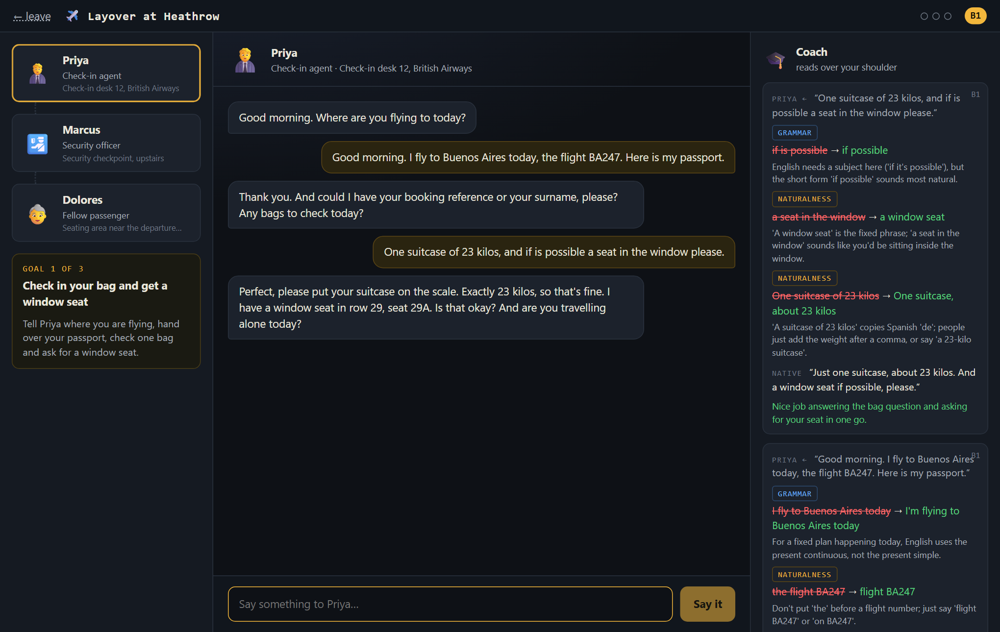
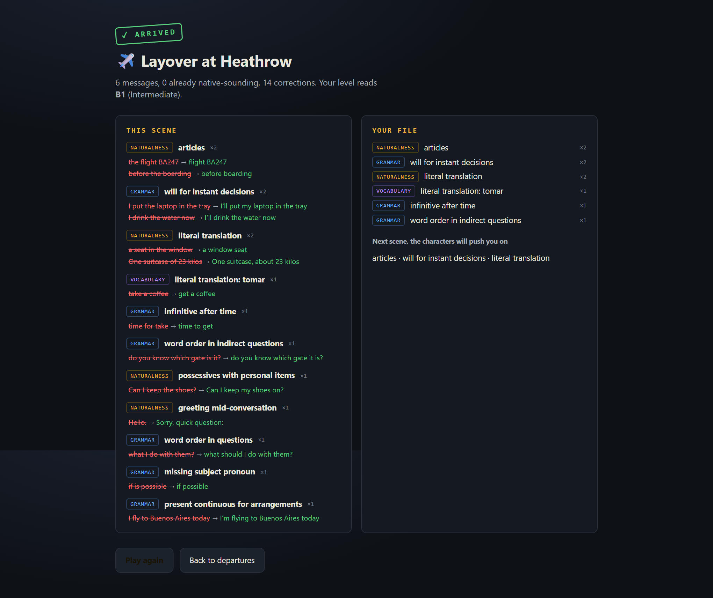

# Layover

**Practise English by getting through real situations, with characters who only speak
English and a coach who remembers what you get wrong.**

You land at Heathrow with a bag to check, a laptop in your backpack and no idea which
gate to go to. The check-in agent, the security officer and the chatty passenger next
to you are Claude agents in character: they know only what their job would know, they
never break immersion, and they never correct you. A coach reads over your shoulder,
marks what a native speaker would have said differently, keeps a file of your
recurring mistakes, and quietly tells the next character to push you on exactly those.



> Status: v0.1. The airport and a hotel scenario are playable end to end with
> `claude-opus-5-5`. Text only; the voice layer is designed but not built.
> See [Roadmap](#roadmap).

## Why another "chat with an AI to learn English"

Plenty of apps let you chat with a bot. Two things are usually missing:

- **The correction breaks the conversation.** The bot stops being a receptionist and
  becomes a teacher. Here the character stays in character; corrections live in a
  side panel as `what you said → what a native would say`, one sentence of why.
- **Nothing remembers you.** Every correction here carries a pattern label
  ("articles", "word order in questions"). Patterns are aggregated per player, shown in
  an end-of-scene review, and the recurring ones are fed to the next NPC's prompt so
  the conversation naturally demands those structures again. The coach also estimates
  your CEFR level per message; a smoothed level (A2–C1) changes the characters'
  vocabulary and pace.



## Run it

```bash
git clone https://github.com/LucasBurriel/layover && cd layover
npm install
cp .env.example .env     # put your ANTHROPIC_API_KEY in it
npm run dev              # server on :8787, UI on http://localhost:5173
```

No API key? If you have [Claude Code](https://claude.com/claude-code) installed and
logged in, leave the key out: the server falls back to the Claude Agent SDK, which uses
your login. Set `LLM_PROVIDER=anthropic|claude-code|mock` to force one.

```bash
npm run dev:mock         # no model at all: scripted NPC + rule-based coach, for UI work
npm test                 # 54 tests, no network
npm run build && npm start   # production build served by the same server
```

Node 20+. The API key lives in the server process only; the browser talks to
`/api/npc` and `/api/coach`.

## How it works

```
browser                               server (Hono, TypeScript)              Claude
───────                               ─────────────────────────              ──────
player types ──► ConversationEngine ──► POST /api/npc  ── system prompt ────► claude-opus-5-5
                      │                   (scene, NPC, knowledge, level,       streams reply
                      │                    weak patterns, history)       ◄─── in character
                      │               SSE: text deltas + [[OBJECTIVE_COMPLETE]] trailer
                      │                   (filtered out before display)
                      │
                      └──────────────► POST /api/coach ── system prompt ────► claude-opus-5-5
                                          (NPC line + player message)         structured JSON
                                      JSON: corrections[], nativeVersion, ◄───
                                            levelEstimate, praise
                      │
            error memory (localStorage) ◄── corrections, by pattern
            smoothed CEFR level         ◄── levelEstimate
```

- **Scenarios are JSON** (`scenarios/*.json`): setting, player role, NPCs with
  personality + a closed knowledge list, ordered objectives with a player-facing hint
  and NPC-facing success criteria. Adding a scenario is adding a file; the server
  validates it with zod at startup.
- **NPC call**: streamed, in character, adaptive thinking at low effort. When the
  objective's success criteria are met the NPC ends with a hidden tag; a small
  streaming filter guarantees the player never sees it.
- **Coach call**: structured output (JSON schema), medium effort, runs in parallel with
  the NPC so the conversation never waits for the correction.
- **Engine** (`src/game/engine.ts`) reads from an `InputChannel` and writes to an
  `OutputChannel`. Today both are text. Voice is a new channel implementation, not a
  rewrite.
- **Deterministic parts are tested**: the stream filter, the coach parser, the error
  memory, level smoothing, the scenario reducer, scenario file validation, the mock.

[DESIGN.md](DESIGN.md) explains the choices (why two calls, why a trailer tag instead
of structured NPC output, how the level is smoothed, what was left out).

## Project layout

```
scenarios/        airport.json, hotel.json          ← add a file to add a scene
shared/           types + zod schemas, NPC/coach wire protocols (used by both sides)
server/           Hono app, prompts, providers/ (anthropic | claude-code | mock)
src/game/         engine, scenario reducer, error memory, level, storage
src/io/           InputChannel / OutputChannel (text now, voice later)
src/ui/           Home, Scene (map + chat + coach panel), Review
tests/            vitest
```

## Add a scenario

Copy `scenarios/hotel.json`, change the ids, write the NPCs. Each NPC needs a
`personality` (how they talk), a `knowledge` list (everything they are allowed to know:
times, prices, rules, directions) and a `location`. Each objective needs a `hint` for
the player and `successCriteria` the NPC uses to decide the goal is done. Restart the
server; the new scene is on the departures board.

## Roadmap

- **Voice**: `SpeechInputChannel` (Web Speech API or an `/stt` endpoint) and a
  `TtsOutputChannel` that speaks from the first sentence while the rest streams. The
  interfaces exist in `src/io/channels.ts` with a TODO.
- **More scenes**: restaurant, job interview, doctor, phone call to the bank (no
  faces, harder listening), returning a faulty product.
- **Coach eval**: a set of real learner messages with gold corrections to measure
  over- and under-correction before tuning the prompt.
- **Server-side memory** so the file follows you across devices.
- **Multiplayer**: two learners in the same scene with one NPC.

## Costs

A full airport run (six player messages) is twelve model calls. With prompt caching on
the system prompts it came to a few cents on Claude Opus 5.5. Set `NPC_MODEL` /
`COACH_MODEL` to swap models.

## License

MIT.
